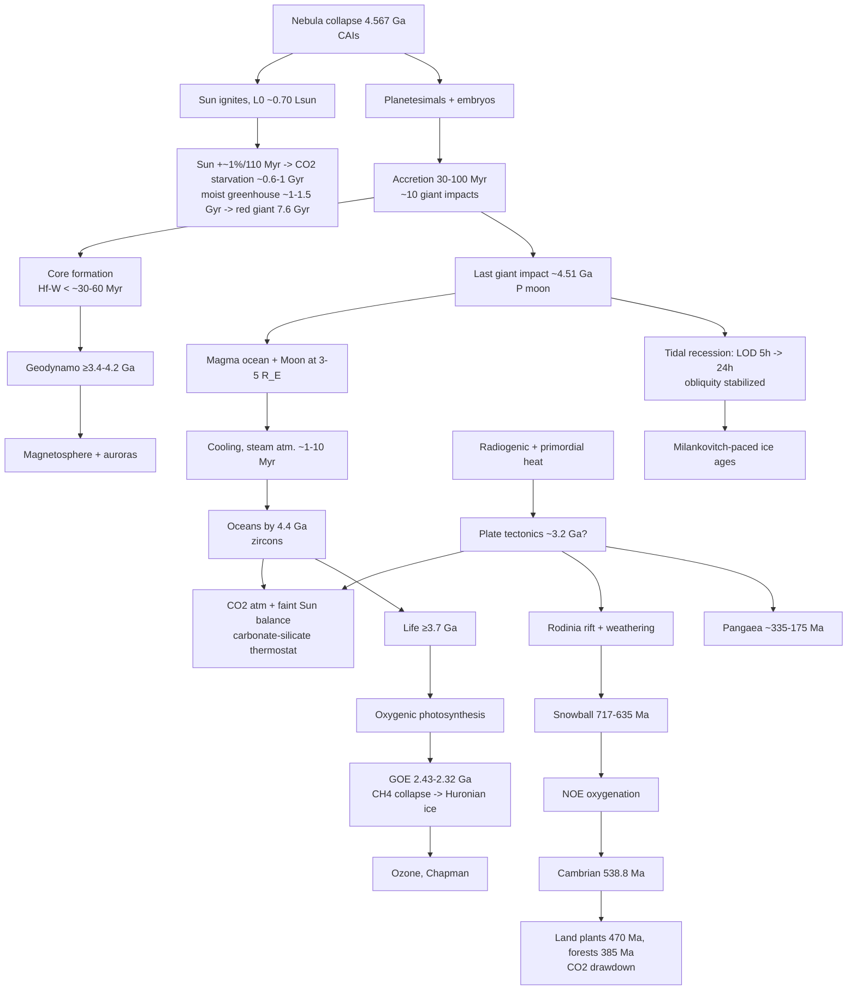

# Deep-time causes: how each event came to be (T-0065)

Matt (2026-10-23): "but then , how did all those events come to be? research and find real numbers"
and: "the moon will need to come from the earliest times, so it would be programmed as a probability: earth's very reason for forming came with the probability of a collision."

Boreal rule: every element emerges from time x rules. This doc lists, for each event, the **mechanism**, the **driving quantities** (cited, with ranges), the **timescale**, and the **sim variables/rules** that should produce it. Machine-readable twin: `src/data/deepTimeCauses.json` (distributions as mean/spread/source). `[disputed]` = no consensus; ranges given. Ga = billion years ago, Ma = million years ago.

## Causal chain



## 1. Nebula collapse and Sun (4.567 Ga)
- **Mechanism:** gravitational collapse of a molecular cloud core; protostar contracts on the Kelvin-Helmholtz timescale until core H fusion (ZAMS).
- **Numbers:** CAI age 4567.30 ± 0.16 Myr (Connelly et al. 2012, Science 338:651). Disk lifetime ~3-5 Myr (Haisch et al. 2001; Wang et al. 2017 paleomagnetism: <4.9 Myr). Pre-main-sequence to ZAMS ~30-50 Myr for 1 Msun. ZAMS luminosity ~0.70-0.72 L_now (Gough 1981; Bahcall et al. 2001).
- **Sim:** `t0 = -4.5673e9 yr`; `L(t) = L0 / (1 + 0.4 (1 - t/t_sun))` (Gough 1981), t_sun = 4.57 Gyr.

## 2. Accretion (stochastic core of the Moon model)
- **Planetesimals:** streaming-instability formation gives a characteristic diameter ~100 km, cumulative N(>D) ∝ D^-q with q ≈ 1.6-2.8 at large sizes (Johansen et al. 2015 Sci. Adv.; Simon et al. 2016; Morbidelli et al. 2009 "asteroids were born big"). Inner-disk surface density in the Minimum Mass Solar Nebula: Σ_solid ≈ 7 g/cm² (1 AU)^-1.5 (Hayashi 1981); ~2-5 Earth masses of solids in 0.5-2 AU. At 1 AU, ~10^7-10^9 bodies of 10-100 km (order of magnitude; derived).
- **Runaway/oligarchic growth:** embryos of ~0.01-0.1 M_E (Moon-to-Mars) in ~0.1-1 Myr, spaced ~10 mutual Hill radii (Kokubo & Ida 1998, 2000).
- **Giant-impact phase (N-body):** Chambers 2001 (Icarus 152:205): 2-4 planets, final Earth analogues after ~100-200 Myr. Raymond et al. 2004/2009; Kokubo & Genda 2010 (ApJL 714:L21): per Earth analogue **~10 ± 4 giant impacts**, impact velocity **v_imp/v_esc = 1.0-1.4 (median ~1.1-1.2)**, impact angle distributed sin(2θ) (peak 45°; Shoemaker 1962), only ~half are perfect mergers ("hit-and-run" ~50% at v>1.2 v_esc, Asphaug 2010; Stewart & Leinhardt 2012). Impactor/target mass ratio γ broad, median ~0.1-0.3. Last giant impact time: 30-150 Myr after CAIs [disputed]; Earth growth to 63% e-folding ~11 Myr (Yin et al. 2002) to ~30-40 Myr.
- **Sim:** seeded Monte Carlo of N_GI ~ Poisson(10), each with γ ~ lognormal(median 0.15, σ_ln 1.0) clipped [0.01,1], v/v_esc ~ U-ish(1.0,1.4), θ ~ sin2θ, merger efficiency f(v,θ).

## 3. Moon-forming impact (~4.51 Ga) and Moon probability
- **Timing:** 4.51 ± 0.01 Ga (Barboni et al. 2017 zircons, ≥4.51); others 4.42-4.47 Ga (Borg et al. 2015; Carlson 2014) [disputed]. ~50-100 Myr after CAIs.
- **Scenarios (all must leave ~1.2% M_E moon, Earth-like isotopes, Earth-Moon angular momentum L_EM = 3.5e34 kg m²/s):**
  - Canonical (Canup & Asphaug 2001 Nature 412:708; Canup 2004): γ ≈ 0.1-0.12 (Mars-size, ~0.11 M_E), θ ≈ 45°, v ≈ v_esc (~9-10 km/s), L ≈ 1.0-1.2 L_EM. Disk ~1-2 lunar masses; isotopic problem (Moon mostly impactor).
  - Fast-spinning Earth (Ćuk & Stewart 2012 Science 338:1047): γ ~0.026-0.1, v ~ 20 km/s, proto-Earth period 2.3-2.7 h; L ≈ 2-3 L_EM, excess removed by evection resonance.
  - Half-Earths (Canup 2012): γ ≈ 0.4-0.5, slow impact.
  - Synestia (Lock et al. 2018 JGR 123:910): high-energy, high-L impact makes a vapor structure; Moon condenses inside it.
  - Multiple impacts (Rufu, Aharonson & Perets 2017 Nat. Geo. 10:89): ~20 smaller impacts (γ 0.01-0.1) each making moonlets; merger yields Moon.
- **Energy:** ½ m v² with m=6.4e23 kg, v=9.3 km/s ⇒ **~3e31 J** (plus gravitational ~10^32 J total, Canup 2004). Melt: whole-mantle or ≥1000-2000 km deep magma ocean (Nakajima & Stevenson 2015; Tonks & Melosh 1993); peak T > 4000-6000 K.
- **P(Moon | giant impact):** per canonical-style impact, fraction of SPH runs making a disk ≥ M_moon ~ 10-30% (Canup 2004; Rufu 2017: ~20% of impacts yield moonlets that survive). Over a whole history, Elser, Moore & Stadel 2011 (Icarus 214:357): **~8% (range 2-20%)** of terrestrial planets get a Moon-mass satellite. Mastrobuono-Battisti et al. 2015: isotopically Earth-like impactor in ~20-40% of cases. [disputed, model-dependent]
- **Initial orbit:** Roche limit 2.9 R_E; Moon accretes at a ≈ 3-5 R_E in ~1-100 yr (Ida, Canup & Stewart 1997; Kokubo et al. 2000; Salmon & Canup 2012).

## 4. Tidal evolution, length of day, obliquity
- **Now:** recession **3.83 ± 0.009 cm/yr** (Dickey et al. 1994 Science 265:482; Williams & Boggs 2016: 3.82). LOD lengthening ~2.3 ms/century tidal (Stephenson et al. 2016: 1.8 observed incl. glacial rebound). Present dissipation 3.7 TW (Egbert & Ray 2000), anomalously high (ocean resonance).
- **History:** tidal rhythmites: 620 Ma (Elatina, Australia) LOD **21.9 ± 0.4 h**, 13.1 ± 0.1 months/yr, a = 96.5% of today, mean recession ~2.2 cm/yr since (Williams 2000 Rev. Geophys. 38:37). 2.45 Ga Weeli Wolli: a ≈ 54.6 R_E (Walker & Zahnle 1986; Williams 2000) [disputed]. 1.4 Ga Xiamaling cyclostratigraphy LOD ~18.7 h (Meyers & Malinverno 2018 PNAS). Possible stalled LOD ~19 h 2.0-1.0 Ga (atmospheric thermal-tide resonance; Zahnle & Walker 1987; Mitchell & Kirscher 2023 Nat. Geo.) [disputed]. Post-impact LOD ~5 h (canonical, from L_EM) or 2-3 h (Ćuk & Stewart).
- **Rule:** da/dt = 3 k2/Q (m/M) (R/a)^5 n a with effective Q varying by ocean geometry; a^(13/2) integration; total L conserved (minus evection). Constant present rate would put the Moon at Earth ~1.5 Ga (Gerstenkorn problem) ⇒ past Q must have been ~3-4x higher (lower dissipation; Webb 1982; Bills & Ray 1999).
- **Tides:** lunar tidal force ~2.2x solar; tidal height scales a^-3 (at 5 R_E, ~ (60/5)^3 ≈ 1700x today's equilibrium tide).
- **Obliquity:** without the Moon, Earth's obliquity would wander chaotically 0-85° (Laskar, Joutel & Robutel 1993 Nature 361:615); with it ±1.3° about 23.3° (22.1-24.5°, 41 kyr). Lissauer et al. 2012 (Icarus 217:77): a moonless prograde Earth varies only ~10-20° over Gyr [disputed]. Sim: precession constant ∝ Moon mass/a³; chaos if precession hits secular resonances (s6 ~ -26"/yr).

## 5. Core formation (Hf-W)
- 182Hf→182W (t½ 8.9 Myr). Earth core mean age ~30 Myr (Kleine et al. 2002 Nature 418:952; Yin et al. 2002), range 30-100 Myr with partial re-equilibration [disputed]. Mars core ~<10 Myr (Dauphas & Pourmand 2011). Mechanism: Fe-metal rainout through magma ocean; potential energy released ~1.5e31 J (~2000 K heating; Flasar & Birch 1973). Sim: core fraction 0.325 M_E; differentiation rate ∝ melt fraction.

## 6. Magma ocean cooling and crust
- Bare radiative cooling σT⁴ at 2000 K ≈ 9e5 W/m²; solidifies in ~kyr. With steam/CO2 atmosphere, OLR capped near the runaway limit ~280 W/m² (Goldblatt et al. 2013) ⇒ **~1-4 Myr** to solidify (Abe 1997; Elkins-Tanton 2008 EPSL 271:181: 0.1-1 Myr deep mantle; Lebrun et al. 2013: ~1 Myr at 1 AU). Hadean heat flow ~3-5x present. Crust: oldest zircons 4.404 ± 0.008 Ga (Wilde et al. 2001 Nature 409:175); oldest rock Acasta gneiss 4.03 Ga (Bowring & Williams 1999).

## 7. Water origin and oceans
- D/H: Earth ocean (VSMOW) 1.56e-4; carbonaceous chondrites CI/CM ~1.4-1.8e-4 (Alexander et al. 2012 Science 337:721); most comets ~3e-4 (2x), 67P 5.3e-4 (Altwegg et al. 2015), 103P Hartley 2 1.6e-4 (Hartogh 2011). Comets ≤ ~10% of water (Morbidelli 2000). Enstatite chondrites may have delivered ~3-23 oceans' H (Piani et al. 2020 Science 369:1110) — local/outgassing source [disputed]. Ocean mass 1.4e21 kg (~0.023% M_E); mantle may hold 1-10 more oceans.
- Condensation: once surface T < ~647 K critical point and OLR exceeds absorbed flux; oceans by 4.4-4.3 Ga (δ18O in Jack Hills zircons, Mojzsis et al. 2001; Wilde 2001). Sim rule: water vapor column condenses when T_surf < T_sat(p).

## 8. Early atmosphere and faint young Sun
- Faint Sun: S ≈ 0.75 S0 at 4 Ga, ~0.80 at 2.5 Ga (Gough 1981). Te would be ~ -20 °C: paradox (Sagan & Mullen 1972), yet liquid water existed.
- Solutions: pCO2 Archean 0.03-1.5 bar at 4.0 Ga, ~0.01-0.3 bar at 2.5 Ga (Kasting 1987; Catling & Zahnle 2020 Sci. Adv.; Krissansen-Totton et al. 2018 PNAS); paleosols ≥0.01-0.1 bar at 2.7 Ga (Sheldon 2006; Driese 2011). CH4 ~10^2-10^4 ppm from methanogens (Pavlov 2000). N2 0.5-1.1 bar [disputed, Som et al. 2016 <0.5]. Lower albedo (less land), H2-N2 CIA.
- Thermostat: silicate weathering W ∝ exp(ΔT/13.7 K)·(pCO2)^β, β≈0.3-0.5 (Walker, Hays & Kasting 1981; Berner 2004). Volcanic CO2 outgassing ~6-10e12 mol/yr today (Marty & Tolstikhin 1998; Burton 2013), higher earlier. Sim: dpCO2/dt = outgassing - weathering(T, land, biota).

## 9. Geodynamo
- Paleointensity record: Jack Hills zircons 4.2 Ga (Tarduno et al. 2015, 2020) [disputed: Weiss 2018]; robust ≥3.45 Ga Barberton (Tarduno 2010) and 3.7 Ga Isua (Nichols et al. 2024, ≥15 μT).
- Early dynamo thermal: needs CMB heat flux > adiabatic (conductive) flux, Q_ad ≈ 13 TW with k ≈ 70-150 W/m/K (Pozzo et al. 2012) or ~4-6 TW with k ≈ 20-30 (Konôpková 2016) [disputed "new core paradox"]. Present Q_CMB 5-17 TW (Lay et al. 2008). MgO/SiO2 exsolution may power early dynamo (O'Rourke & Stevenson 2016; Badro 2016).
- Inner core nucleation: 0.5-1.5 Ga (Labrosse 2015: <0.7 Ga; Biggin et al. 2015: ~1-1.5 Ga; Bono et al. 2019: ~565 Ma weak field) [disputed]; growth adds compositional buoyancy. Sim: dynamo on if Q_CMB > Q_ad or inner core growing; dipole strength ∝ (buoyancy flux)^(1/3) (Christensen & Aubert 2006).

## 10. Radiogenic heat and plate tectonics
- Heat flow now **46 ± 3 TW** (Davies & Davies 2010: 47 TW; Jaupart et al. 2007: 46). Radiogenic (BSE) ~20 TW (range 11-33; KamLAND/Borexino geoneutrinos 2011/2020); Urey ratio ~0.3-0.5. Contributions today: 238U ~7.7 TW, 232Th ~8.3, 40K ~3.3, 235U ~0.33 (McDonough & Sun 1995; Turcotte & Schubert). Half-lives: 238U 4.468 Gyr, 235U 0.704 Gyr, 232Th 14.05 Gyr, 40K 1.248 Gyr. Radiogenic power at 4.5 Ga ~4x present.
- Mantle potential T: ~1350 °C now, peak ~1500-1600 °C at ~3.0 Ga (Herzberg et al. 2010).
- Onset of modern-style plates: ~3.2-2.5 Ga mainstream (Cawood 2018; Shirey & Richardson 2011 eclogitic diamonds ~3.0 Ga); claims from 4.2 Ga to 0.8 Ga [disputed]. Mechanism: lithosphere yield stress < convective stress; hotter mantle → weaker, more buoyant plates (stagnant/squishy lid). Sim: plates on when mantle T falls below ~T_crit and lithosphere has water; speed 2-10 cm/yr (DeMets 2010).

## 11. Origin of life
- Evidence: 3.48 Ga Dresser stromatolites (Djokic 2017); 3.7 Ga Isua stromatolites (Nutman 2016) [disputed: Allwood 2018]; 3.95 Ga graphite Labrador (Tashiro 2017) [disputed]; 4.1 Ga carbon in zircon (Bell et al. 2015 PNAS) [disputed]. LUCA molecular-clock ~4.2 Ga (Moody et al. 2024 Nat. Ecol. Evol.) [disputed]. Mechanism unknown: hydrothermal vents / wet-dry pools. Sim: probabilistic emergence once liquid water + energy gradients exist; hazard rate unconstrained (choose expectation ~100-300 Myr after oceans).

## 12. Cyanobacteria and the GOE
- Oxygenic photosynthesis ≥2.7-3.0 Ga ("whiffs" 2.5 Ga, Anbar 2007) [disputed]. GOE: loss of mass-independent S fractionation 2.43-2.32 Ga (Gumsley 2017; Poulton et al. 2021: oscillations to 2.22 Ga). pO2 rose from <1e-5 PAL (Pavlov & Kasting 2002) to >1e-2 PAL.
- Balance: O2 source = organic C burial (~10e12 mol/yr today, Holland 2002); sinks = reduced volcanic/metamorphic gases (H2, CH4, Fe²⁺). GOE when source > reductant flux (K_oxy > 1; Catling & Claire 2005; Holland 2009). H escape oxidizes Earth (Catling 2001).
- CH4 collapse: CH4 oxidized, greenhouse loss → Huronian glaciations ~2.45-2.22 Ga (Kopp 2005; Bekker 2014). Sim: O2 reservoir ODE with tipping (bistability, Goldblatt et al. 2006).

## 13. Ozone (Chapman)
- O2 + hν(<242 nm) → 2O; O + O2 + M → O3; O3 + hν(<320 nm) → O2 + O; O + O3 → 2O2 (Chapman 1930); plus NOx/HOx/Cl catalytic cycles. Column today ~300 DU. Shield significant (column >~100 DU) once pO2 ≳ 1e-3-1e-2 PAL (Kasting & Donahue 1980; Segura 2003). Sim: column O3 = f(pO2) from 1D model lookup (Gebauer 2017).

## 14. Snowball Earth (Sturtian 717-660 Ma, Marinoan ~650-635 Ma)
- Ages: Sturtian 717.4-659.7 Ma, Marinoan end 635.2 ± 0.6 Ma (Macdonald 2010; Rooney et al. 2015; Hoffman et al. 2017 Sci. Adv.).
- Trigger: Rodinia breakup at low latitudes boosts weathering, pCO2 falls; ice-albedo runaway when ice line reaches ~25-30° latitude (Budyko 1969; Sellers; North 1975). Sea ice albedo 0.5-0.8, bare ocean 0.06.
- Exit: volcanic CO2 accumulates without weathering to ~0.1-0.3 bar (~300-1000x PAL; Pierrehumbert 2004 needed ≥0.2 bar; Abbot et al. 2012 dust lowers to ~0.01-0.1); ~3-10 Myr build-up; deglaciation → cap carbonates. Sim: energy balance + CO2 cycle should reproduce hysteresis.

## 15. NOE and Cambrian
- Neoproterozoic Oxygenation 800-540 Ma; pO2 to ~0.1-1 PAL (Och & Shields-Zhou 2012; Lyons 2014 Nature 506:307) [disputed timing]. Ediacaran biota 575 Ma. Cambrian base 538.8 ± 0.2 Ma (ICS 2023; Linnemann 2019). Animal O2 threshold ~0.5-4% PAL for sponges (Mills et al. 2014); predators need ~10% PAL (Sperling 2013).

## 16. Land plants, forests, CO2 drawdown
- Embryophyte spores ~470 Ma (Wellman 2003; Rubinstein 2010 Middle Ordovician); molecular clocks 515-470 Ma. First forests Middle Devonian ~385 Ma (Gilboa; Stein 2007; Cairo, Stein et al. 2019). Roots enhance weathering 2-10x (Berner 1997). CO2 fell from ~2000-4000 ppm (Devonian) to ~300-500 ppm by late Carboniferous (Foster, Royer & Lunt 2017; Berner GEOCARB III 2001). Contributes to Late Paleozoic Ice Age (~340-290 Ma).

## 17. Mass extinctions
| Event | Age | Cause | Key numbers |
|---|---|---|---|
| End-Ordovician | 445 Ma | glaciation, cooling | ~85% species lost |
| Late Devonian | 372 Ma | anoxia (Kellwasser), plants? | ~75% |
| End-Permian | 251.9 Ma (251.902 ± 0.024; Burgess 2014 PNAS) | Siberian Traps LIP: ~3-4e6 km³ magma, ~10^4-10^5 Gt CO2 over <~60 kyr pulses; warming +10 °C, ocean acidification/anoxia | ~81-90% marine species |
| End-Triassic | 201.5 Ma | CAMP LIP | ~76% |
| K-Pg | 66.04 Ma (Renne 2013; Sprain 2018) | Chicxulub impact, ~10-12 km bolide at ~20 km/s ⇒ **~1e23-5e23 J** (100 Tt TNT ~4e23 J, Schulte et al. 2010 Science 327:1214); 180 km crater; + Deccan Traps | ~76% species |

Sim: impact flux sampled stochastically (Poisson; ≥10 km impactors ~1 per 100-200 Myr, Stuart & Binzel 2004); LIP events from mantle plume rule.

## 18. Supercontinents and Milankovitch
- Supercontinent cycle ~400-600 Myr (Nuna 1.6 Ga, Rodinia 1.0-0.75 Ga, Pangaea assembled ~335-320 Ma, rifting ~200 Ma, Atlantic opening ~175 Ma) (Nance & Murphy 2014; Torsvik & Cocks 2017).
- Milankovitch: obliquity 41 kyr (22.1-24.5°), precession ~19/23 kyr, eccentricity 95/125 kyr and 405 kyr (e 0.0-0.06) (Laskar et al. 2004; Berger 1978). Ice ages require low CO2 (<~280-400 ppm) and polar land; Hays, Imbrie & Shackleton 1976; Mid-Pleistocene Transition 41→100 kyr ~1.2-0.8 Ma. Northern glaciation onset 2.7 Ma.

## 19. Future
- Solar brightening ~1%/110 Myr (~9%/Gyr; Gough 1981; Caldeira & Kasting 1992).
- C3 photosynthesis CO2 floor 150 ppm in ~0.6-0.9 Gyr; C4 floor 10 ppm in ~0.9-1.2 Gyr (Caldeira & Kasting 1992 Nature 360:721; Lenton & von Bloh 2001; Ozaki & Reinhard 2021: O2 collapse ~1.08 ± 0.14 Gyr).
- Moist greenhouse at S ≈ 1.1-1.15 S0 ⇒ ~1-1.5 Gyr (Kasting 1988; Wolf & Toon 2015: ~1.5 Gyr; Leconte 2013 runaway at ~375 W/m² absorbed). Ocean loss via H escape ~1-2 Gyr later.
- Red giant tip ~7.59 Gyr, Earth likely engulfed (Schröder & Smith 2008 MNRAS 386:155) [disputed]. Moon recedes until LOD = month ~47 days if Sun weren't evolving (never reached).

## 20. Seeded algorithm (Moon as probability)
Our Earth is **reference seed 0**: every draw replaced by the observed value, so the run reproduces today (M_E, LOD 24 h, a_Moon 60.3 R_E, obliquity 23.44°).

```
rng = PRNG(worldSeed)
1. Disk: Σ1 ~ LogNormal(7 g/cm², σln 0.5); embryos ~ M_disk(0.5-2 AU)/M_emb, M_emb ~ LogU(0.01,0.1) M_E
2. Collision history for the Earth analogue:
     N_GI ~ Poisson(10); times t_i sorted ~ ExpDecay(τ 30 Myr) within 1-150 Myr
     for each: γ_i ~ LogNormal(ln 0.15, 1.0) clip[0.01,1]; v/v_esc ~ Triangular(1.0,1.1,1.4);
               θ ~ pdf sin2θ; outcome = merge | graze | hit-and-run (Leinhardt & Stewart 2012 regimes)
               M += eff·m_imp; L_spin += m_imp·v·b (b = R sinθ), random sign/orientation
3. Planet: mass M_final, core fraction from Hf-W (~0.32), spin ω = L/(0.33 M R²), obliquity from L vector.
4. Moon: for the last ≤3 impacts, P_disk = f(γ, θ, v, L) (≈0.1-0.3 canonical-like, lower otherwise);
     M_disk ~ LogNormal(1.5 M_moon, σln 0.7) if success; Moon mass = 0.3-0.5 M_disk (Ida 1997 efficiency);
     multiple-impact path: moonlets merge with P ~0.2-0.5 (Rufu 2017). Overall P(Moon) target ≈ 0.08 (2-20%).
     a0 ~ U(3,5) R_E.
5. Tidal evolution: integrate da/dt = 3 (k2/Q)(m/M)(R/a)^5 n a, with Q(t) from ocean basin state
     (seed 0 calibrated: 3.83 cm/yr now, 21.9 h at 620 Ma, a=0.965 a_now at 620 Ma); conserve L_EM; evection skip unless fast-spin.
6. Obliquity: if Moon present, precession k ∝ m/a³ ⇒ stable ±1.3°; else chaotic walk (Laskar 1993) range 0-85°.
```
Outputs feed `deepTime` stages, tides layer, day length and the Milankovitch forcing.

## Sources
All are cited inline (author year journal). Numbers marked [disputed] have ranges in the JSON.
