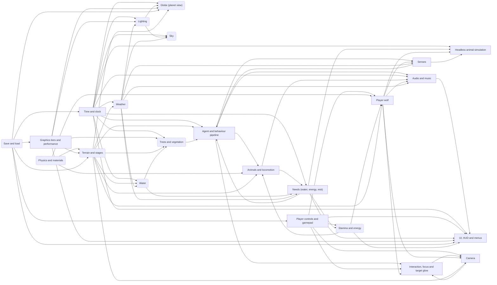

# Boreal system map

Generated from `src/config/systemProperties.ts` by `npm run system-map` (tools/system-map.ts). Do not edit by hand:
change the properties file and regenerate; `npm test` fails when this page is stale. How to add a system or a figure:
`notes/skills/system-properties.md`.

Arrows point from a system to the systems that read its output ("feeds"). Dashed boxes are systems whose figures are still
all at their call sites (see each section's links and "still in code").

## Systems

| System | What it does | Groups in the file | Depends on | Feeds | URL flags |
|---|---|---|---|---|---|
| [Headless animal simulation](#animalSim) | Every animal as pure data + logic on a fixed tick (no renderer): species template needs, stamina, senses, diets (carnivore hunt / herbivore graze), group awareness and vigilance. Renderers read it through adapters. | `hunt`, `perception`, `sim`, `social` | needs, senses, player, clock | - | - |
| [Audio and music](#audio) | Ambience, animal calls, footsteps, wolf voice, music decks and the bus mixer. | `footsteps` | clock, weather, locomotion, behaviour, player | ui | 1 |
| [Agent and behaviour pipeline](#behaviour) | Animal brains: senses -> problem (explore, escape, feed ...) -> motion intent; deer herds, hares, people. | `behaviour` | senses, needs, terrain, clock, vegetation | audio, interaction, locomotion, senses | 2 |
| [Camera](#camera) | Third-person follow camera: a rear three-quarter just above the wolf, pitch spring and look-around. | `camera` | player, controls, terrain, interaction | interaction | 2 |
| [Time and clock](#clock) | The one world clock (frozen in menus), game hour, date and sun position; chronometer offset. | `clock`, `chronometer` | save | animalSim, audio, behaviour, globe, lighting, needs, sky, ui, vegetation, water, weather | 2 |
| [Player controls and gamepad](#controls) | One bindings table (keys + gamepad per action), dead zones, rebinding UI, haptics. | `haptics` | save | camera, interaction, player, stamina, ui | - |
| [Globe (planet view)](#globe) | Cube-sphere planet, atmosphere, far layer and the descent from orbit to the ground. | - | terrain, clock, lighting, quality, save | - | 19 |
| [Interaction, focus and target glow](#interaction) | Picking the interaction target, held focus lock and steering, the glowing outline. | `autoFocus`, `targetGlow` | controls, player, behaviour, camera | camera | 1 |
| [Lighting](#lighting) | Physical sun/moon illuminance, exposure, ambient and night vision. | - | clock, weather, quality | globe, sky | - |
| [Animals and locomotion](#locomotion) | Gaits, central pattern generator, IK, posture, jumps and the rigs that draw them. | `jump` | behaviour, stamina, physics, terrain | audio, needs | 2 |
| [Needs (water, energy, rest)](#needs) | Species needs drained at real-world rates, thought bubbles and alerts, needs-driven goals. | `needsThoughts` | clock, locomotion, water, weather | animalSim, behaviour, stamina, ui | 1 |
| [Physics and materials](#physics) | Gravity from G and Earth, densities and compositions, contact seating. | - | - | locomotion, player, terrain | - |
| [Player wolf](#player) | Embodied wolf movement: mode speeds, pounce and the move/steer step. | `movement` | controls, stamina, physics, terrain | animalSim, audio, camera, interaction, senses | - |
| [Graphics tiers and performance](#quality) | One quality ladder, the governor that steps it, render settings caps and the interest radius. | `quality` | save | globe, lighting, terrain, ui, vegetation | 2 |
| [Save and load](#save) | localStorage keys: clock, hour offset, ground, weather, deltas, bindings, settings, seed, player. | - | - | clock, controls, globe, quality, terrain, ui | - |
| [Senses](#senses) | Hearing and smell: scent plumes, sound cues, the senses HUD and the halo ring. | `senses`, `sensesHalo` | weather, player, behaviour | animalSim, behaviour | - |
| [Sky](#sky) | Sky dome, sun and moon discs, clouds drawn from the weather cells. | - | clock, lighting, weather | - | - |
| [Stamina and energy](#stamina) | Run / sprint stamina, exhaustion and refill; energy spent by distance and ground cost. | - | controls, needs | locomotion, player, ui | - |
| [Terrain and stages](#terrain) | Staged terrain: eroded elevation, soils, rivers and lakes; chunks, ground layers and rocks. | - | quality, save, physics | behaviour, camera, globe, locomotion, player, vegetation, water, weather | 2 |
| [UI, HUD and menus](#ui) | Start / pause menu, settings panel, HUD status line, loading screen, chronometer, inspector, photo mode. | `links`, `loading` | clock, stamina, needs, quality, audio, controls, save | - | 1 |
| [Trees and vegetation](#vegetation) | Stands and fire history, procedural trees (v2), far trees, flora, mosses and grass. | - | terrain, water, quality, clock | behaviour | 5 |
| [Water](#water) | Lake plane, river planform and flow, shore bands and water optics. | - | terrain, weather, clock | needs, vegetation | - |
| [Weather](#weather) | A small 3-D atmosphere grid over the player: temperature, wind, cloud and rain from station normals. | - | clock, terrain | audio, lighting, needs, senses, sky, water | - |

## Headless animal simulation (`animalSim`)

Every animal as pure data + logic on a fixed tick (no renderer): species template needs, stamina, senses, diets (carnivore hunt / herbivore graze), group awareness and vigilance. Renderers read it through adapters.

- Depends on: needs, senses, player, clock
- Feeds: nothing (a leaf)
- Modules: `src/core/sim/index.ts`, `src/core/needs/senses.ts`, `src/core/needs/diet.ts`, `src/core/needs/social.ts`, `src/animals/hare.ts`, `src/core/hunt.ts`, `src/core/huntHold.ts`

### `SYSTEM_PROPERTIES.hunt`

Read by: `src/core/needs/diet.ts`, `src/core/hunt.ts`, `src/core/huntHold.ts`

| Figure | Value | Units | What | Source |
|---|---|---|---|---|
| `catchContact` | 0.9 | m | m body contact that catches (~ half a wolf + half a hare); m a landing pounce catches within (+ jaw reach) | half a wolf (head-body 1.0-1.3 m, Mech & Boitani 2003) + half a hare; tuned by tools/hunt-sim |
| `catchPounce` | 1.2 | m | m body contact that catches (~ half a wolf + half a hare); m a landing pounce catches within (+ jaw reach) | catchContact + jaw reach; estimate (game calibration) |
| `boltBase` | 0.5 | x flight distance | flight starts when the predator is inside flight.distanceM x (boltBase + boltPerLevel x perception) | estimate (game calibration) |
| `boltPerLevel` | 1.5 | x flight distance per perception | flight starts when the predator is inside flight.distanceM x (boltBase + boltPerLevel x perception) | estimate (game calibration) |
| `safeDistance` | 35 | m | m from the predator at which a fleeing prey calms down | estimate (game calibration) |
| `minZig` | 0.2 | s | s a prey commits to a zig before it may re-aim (turns are grip-limited, see evasion.lateralAccel) | estimate (game calibration) |
| `jinkRadii` | 1 | x pursuer turning radius | jink (Howland 1974): when the pursuer is within jinkRadii x its turning radius v^2/a, turn jinkAngle rad off the straight-away line (pi/2 = Howland's optimum, perpendicular), at most every jinkEvery s | Howland 1974 (J Theor Biol 47:333): turn when the pursuer is about one turning radius away |
| `jinkAngle` | 1.57 | rad | jink (Howland 1974): when the pursuer is within jinkRadii x its turning radius v^2/a, turn jinkAngle rad off the straight-away line (pi/2 = Howland's optimum, perpendicular), at most every jinkEvery s | Howland 1974: the optimal evasive turn is perpendicular |
| `jinkEvery` | 1 | s | jink (Howland 1974): when the pursuer is within jinkRadii x its turning radius v^2/a, turn jinkAngle rad off the straight-away line (pi/2 = Howland's optimum, perpendicular), at most every jinkEvery s | estimate (game calibration) |
| `lockDwell` | 0.2 | s | s the view must stay on a prey before it locks. Regular saccade latency is about 200 ms (Fischer & Ramsperger 1984, Exp Brain Res 57:191); a shorter glance does not lock. | Fischer & Ramsperger 1984, Exp Brain Res 57:191: regular saccade latency ~200 ms |
| `lockHalfDeg` | 30 | deg | degrees either side of the view. 60° is the upper end of the dog's behavioural binocular overlap (Miller & Murphy 1995, JAVMA 207:1623: 30–60°). Half of that overlap is 30°. | Miller & Murphy 1995, JAVMA 207:1623: dog binocular overlap 30–60°, upper end, half either side of the view |
| `lockRadius` | 30 | m | m. A stalking approach still alerts white-tailed deer inside 30 m (Lingle & Wilson 2001, Ethology 107:125). The lock uses that distance for any prey: beyond it, holding aim does not commit. | Lingle & Wilson 2001, Ethology 107:125: stalking attacks alerted deer under 30 m |
| `leapGrip` | 13 | m/s^2 | m/s² ceiling on the leap's turn (v²/r). Wilson et al. 2013, Nature 498:185: cheetah hunts often exceed 13 m/s² below 17 m/s. No wolf lateral acceleration was found; a wolf is not allowed to turn harder than that. | Wilson et al. 2013, Nature 498:185: cheetah lateral acceleration often above 13 m/s^2 below 17 m/s; used as a ceiling |
| `friendTau` | 180 | play s | Play seconds a released prey treats the wolf as a friend. Matthew 2026-10-21: about 3 min. The game clock is 12x, so this is play time, not world time (180 world-seconds would feel like 15 s). Inside the tonic-immobility range (seconds to several minutes: Whishaw, Flannigan & Barnsley 1979, Dev Psychobiol 12:595). | Matthew 2026-10-21: friendship about 3 min. Whishaw, Flannigan & Barnsley 1979, Dev Psychobiol 12:595: tonic immobility lasts seconds to several minutes |
| `friendFloor` | 0.36787944117144233 | share of strength | Strength exp(-t/tau) is still a friend at exactly one e-folding, and not after. | exp(-1): the memory is live through one e-folding and gone after it |
| `gutA` | 0.096 | kg / kg^gutB | Wet stomach + caecum + upper colon = gutA * mass^gutB (kg, kg). Belovsky 1984, Theor. Popul. Biol. 25:235, n=6, r^2=0.99. Read as kilograms (~10 % at 1.5 kg). Mendel & Mendel 1909, J Exp Med 11:36, rabbit stomach+cecum ~10 % of body weight. If the 1984 fit was in grams, this reading is high. | Belovsky 1984, Theor. Popul. Biol. 25:235: wet stomach+caecum+upper colon = 0.096*W^1.03 (n=6, r^2=0.99). Unit read as kg; Mendel & Mendel 1909 J Exp Med 11:36 is the ~10% check |
| `gutB` | 1.03 | exponent | Wet stomach + caecum + upper colon = gutA * mass^gutB (kg, kg). Belovsky 1984, Theor. Popul. Biol. 25:235, n=6, r^2=0.99. Read as kilograms (~10 % at 1.5 kg). Mendel & Mendel 1909, J Exp Med 11:36, rabbit stomach+cecum ~10 % of body weight. If the 1984 fit was in grams, this reading is high. | Belovsky 1984, Theor. Popul. Biol. 25:235 (same fit) |

### `SYSTEM_PROPERTIES.perception`

Read by: `src/core/needs/senses.ts`

| Figure | Value | Units | What | Source |
|---|---|---|---|---|
| `notice` | 0.25 | 0-1 | perception level (0..1) at which an animal notices another | estimate (game calibration) |
| `cueAt` | 0.15 | 0-1 | embodied-player predator cue: level at which it shows; s it lingers after the predator is lost | estimate (game calibration) |
| `cueLinger` | 2 | s | embodied-player predator cue: level at which it shows; s it lingers after the predator is lost | estimate (game calibration) |

### `SYSTEM_PROPERTIES.sim`

Read by: `src/core/sim/index.ts`

| Figure | Value | Units | What | Source |
|---|---|---|---|---|
| `step` | 0.03333333333333333 | s | s fixed sub-step (coarse ecosystem ticks may raise it); game s per sim s (the world clock: 300 real s per game hour = x12) | design (30 Hz like the player sim) |
| `timeScale` | 12 | game s / sim s | s fixed sub-step (coarse ecosystem ticks may raise it); game s per sim s (the world clock: 300 real s per game hour = x12) | clock.realSecondsPerGameHour 300 -> 3600/300 = 12 |
| `cell` | 25 | m | m spatial-grid cell; m scent search radius (as senses.range) | estimate (game calibration) |
| `scentRange` | 40 | m | m spatial-grid cell; m scent search radius (as senses.range) | senses.range |
| `biteReach` | 0.6 | m | m a grazer reaches food from; Energy % above which it stops seeking food | estimate (game calibration) |
| `fullAt` | 90 | 0-100 | m a grazer reaches food from; Energy % above which it stops seeking food | estimate (game calibration) |
| `waterStep` | 2 | m | m ring step of the water search | estimate (game calibration) |
| `chaseAt` | 6 | m | NPC predator: m it breaks from stalk to chase; stalk speed x walk; m it pounces from; s pounce, s cooldown, speed carry (as movement) | estimate (game calibration) |
| `stalkSpeed` | 0.2 | x walk | NPC predator: m it breaks from stalk to chase; stalk speed x walk; m it pounces from; s pounce, s cooldown, speed carry (as movement) | estimate (game calibration) |
| `pounceAt` | 3 | m | NPC predator: m it breaks from stalk to chase; stalk speed x walk; m it pounces from; s pounce, s cooldown, speed carry (as movement) | estimate (game calibration) |
| `pounceSeconds` | 0.85 | s | NPC predator: m it breaks from stalk to chase; stalk speed x walk; m it pounces from; s pounce, s cooldown, speed carry (as movement) | core/animalBehavior jump length |
| `pounceCooldown` | 1.5 | s | NPC predator: m it breaks from stalk to chase; stalk speed x walk; m it pounces from; s pounce, s cooldown, speed carry (as movement) | core/animalBehavior jump cooldown |
| `pounceCarry` | 1.15 | x speed | NPC predator: m it breaks from stalk to chase; stalk speed x walk; m it pounces from; s pounce, s cooldown, speed carry (as movement) | movement.pounceCarry |
| `restBout` | 60 | s | s of one NPC rest bout | estimate (game calibration) |

### `SYSTEM_PROPERTIES.social`

Read by: `src/core/needs/social.ts`, `src/core/sim/index.ts`

| Figure | Value | Units | What | Source |
|---|---|---|---|---|
| `maxHops` | 6 | links | most links an alarm passes along a chain of mates (bounds the relay) | estimate (game calibration) |
| `memorySeconds` | 2 | s | s a detection stays "known" after the animal last perceived the predator | estimate (game calibration) |

**Linked data tables** (kept in their own module)

- `NEEDS_SPECIES` in `src/core/needs/species/index.ts`: species templates: senses, diet, social, evasion
- `HUNT_LOCK` in `src/core/hunt.ts`: aim dwell, binocular cone, lock radius, leap turn ceiling
- `HUNT_HOLD` in `src/core/huntHold.ts`: friend memory, gut allometry, pin and carry pose figures

## Audio and music (`audio`)

Ambience, animal calls, footsteps, wolf voice, music decks and the bus mixer.

- Depends on: clock, weather, locomotion, behaviour, player
- Feeds: ui
- Modules: `src/audio/borealSound.ts`, `src/audio/footsteps.ts`, `src/audio/mixer.ts`, `src/audio/music.ts`, `src/audio/musicSettings.ts`, `src/audio/wolfVoice.ts`, `src/core/callField.ts`

### `SYSTEM_PROPERTIES.footsteps`

Read by: `src/audio/footsteps.ts`

| Figure | Value | Units | What | Source |
|---|---|---|---|---|
| `minGap` | 0.09 | s | paws landing closer than this (s) merge into one sound | estimate (game calibration) |
| `pitchJitter` | 0.05 | share | per-step random pitch (+- share) | estimate (game calibration) |
| `gainJitter` | 0.25 | share | per-step random level cut (share) | estimate (game calibration) |
| `foreRate` | 0.96 | x | playback rate of fore paws (heavier forequarters) | fore legs carry ~60 % of a dog's weight (Lee et al. 1999, J Exp Biol 202:3565) |
| `hindRate` | 1.04 | x | playback rate of hind paws | Lee et al. 1999 (as foreRate) |
| `pairBoost` | 0.2 | share | extra level per additional paw landing together | estimate (game calibration) |

**URL flags**

| Flag | Effect |
|---|---|
| `?tones` | show the isochronic / binaural tone controls (grok/music, T-0033) |

**Linked data tables** (kept in their own module)

- `MIX` in `src/audio/borealSound.ts`: clip gains and spatial mix
- `SOUND_IDS` in `src/audio/borealSound.ts`: every sound clip id
- `CALLERS` in `src/core/callField.ts`: loon territory and wail counts, woodpecker density and drum rate
- `VOICES` in `src/audio/mixer.ts`: voice limits and priorities
- `CULL_DISTANCE` in `src/audio/mixer.ts`: sounds beyond this are culled
- `MUSIC` in `src/audio/music.ts`: music deck crossfade and ducking

**Still in code** (not moved yet)

- audio/mixer + audio/music figures (grok/music, T-0033, is changing them; move after it merges)

## Agent and behaviour pipeline (`behaviour`)

Animal brains: senses -> problem (explore, escape, feed ...) -> motion intent; deer herds, hares, people.

- Depends on: senses, needs, terrain, clock, vegetation
- Feeds: audio, interaction, locomotion, senses
- Modules: `src/core/animalBehavior.ts`, `src/core/autonomy.ts`, `src/core/agent.ts`, `src/animals/hare.ts`, `src/core/why.ts`, `src/core/events.ts`, `src/core/lifespan.ts`

### `SYSTEM_PROPERTIES.behaviour`

Read by: `src/core/animalBehavior.ts`

| Figure | Value | Units | What | Source |
|---|---|---|---|---|
| `defaultEnergy` | 75 | 0-100 | energy an animal starts with, 0-100 | estimate (game calibration) |
| `forageEnergy` | 18 | 0-100 | energy gained from one forage patch, 0-100 | estimate (game calibration) |
| `playerHearingRadius` | 40 | m | an animal hears the player within this distance (m) | estimate (game calibration) |
| `feedDuration` | 2 | s | seconds spent eating at a forage patch before it is consumed | estimate (game calibration) |
| `feedReach` | 1 | m | distance (m) from a forage patch at which an animal stops to eat | estimate (game calibration) |
| `threatMemory` | 3 | s | seconds a sensed threat is remembered after leaving the senses (stops flip-flopping at the outer ring) | estimate (game calibration) |
| `senseRadii` | [3, 10, 24] | m | sense rings (m): touch, near, far | estimate (game calibration) |

**URL flags**

| Flag | Effect |
|---|---|
| `?contacts` | =1 logs every solid contact (main.ts) |
| `?watch` | =hare follows a hare (grok/rabbit-clover, T-0009) |

**Linked data tables** (kept in their own module)

- `MAMMAL_PLANS` in `src/core/species.ts`: body plans per mammal archetype
- `MAMMALS` in `src/core/species.ts`: mammal species rows
- `HARE` in `src/animals/hare.ts`: snowshoe hare agent figures
- `DEER_AGENT` in `src/core/species.ts`: white-tailed deer agent figures
- `LIFESPAN` in `src/core/lifespan.ts`: maximum and starting ages
- `WHY_DEFAULTS` in `src/core/why.ts`: why-chains per object kind
- `BLOCK` in `src/core/tuning.ts`: step height and trunk clearance per animal

**Still in code** (not moved yet)

- core/autonomy autonomous wolf figures
- animals/hare HARE (T-0009 is changing it)

## Camera (`camera`)

Third-person follow camera: a rear three-quarter just above the wolf, pitch spring and look-around.

- Depends on: player, controls, terrain, interaction
- Feeds: interaction
- Modules: `src/render/math.ts`, `src/render/buildScene.ts`

### `SYSTEM_PROPERTIES.camera`

Read by: `src/render/math.ts`

| Figure | Value | Units | What | Source |
|---|---|---|---|---|
| `defaultPitchDeg` | -5 | deg | resting pitch (deg). Negative looks above the horizon. -5 puts the mid-body near the measured issue #52 centroid (image y 0.74, NDC y -0.48) when the lens is riderHeight. Game calibration of the angle. | estimate (game calibration) |
| `lookPitchRangeDeg` | 30 | deg | how far the look stick tilts up or down from the default (deg) | estimate (game calibration) |
| `lookSpringRate` | 14 | 1/s | look-pitch spring return rate (1/s): 98 % settled in 0.3 s, no overshoot | estimate (game calibration) |
| `riderHeight` | 1.05 | m | metres above the ground. Gray-wolf withers are 80–85 cm (Mech 1970, The Wolf; Wikipedia "Wolf" restates it). The lens sits 20 cm above an 85 cm withers, so the view is the animal's, not a standing person's. | withers 80–85 cm (Mech 1970, The Wolf) plus 20 cm, so the lens is just above the back |
| `riderDistance` | 3.6 | m | metres behind the hips along the trail, at riderHeight. Scales with height. Game calibration so an 85 cm wolf is about a quarter of a 48° frame, the way the animal sits in issue #52. | estimate (game calibration) |
| `flank` | 2.25 | m | metres to the animal's left, at riderHeight. atan2(flank, riderDistance) is 32°, inside a rear three-quarter (25–45° off the tail; 0° is dead astern, 90° is side-on). Game calibration of that angle. | estimate (game calibration) |
| `pitchMinDeg` | -80 | deg | hard pitch limits (deg): negative looks above the horizon | estimate (game calibration) |
| `pitchMaxDeg` | 89 | deg | hard pitch limits (deg): negative looks above the horizon | estimate (game calibration) |

**URL flags**

| Flag | Effect |
|---|---|
| `?at` | =x,z[,yaw] start position (main.ts) |
| `?fov` | field of view override (grok/rabbit-clover, T-0009) |

**Still in code** (not moved yet)

- main.ts mouse-drag look sensitivity and look-yaw return rate
- render/buildScene base field of view (48 deg; the focus field of view is autoFocus.cameraFovDeg)

## Time and clock (`clock`)

The one world clock (frozen in menus), game hour, date and sun position; chronometer offset.

- Depends on: save
- Feeds: animalSim, audio, behaviour, globe, lighting, needs, sky, ui, vegetation, water, weather
- Modules: `src/core/timeOfDay.ts`, `src/core/worldClock.ts`, `src/core/timescale.ts`, `src/ui/chronometer.ts`, `src/core/deepTime.ts`

### `SYSTEM_PROPERTIES.clock`

Read by: `src/core/timeOfDay.ts`, `src/core/worldClock.ts`

| Figure | Value | Units | What | Source |
|---|---|---|---|---|
| `realSecondsPerGameHour` | 300 | s | real seconds per game hour (300 = a full day in 2 real hours) | design (2 real h per game day) |
| `latitudeDeg` | 49.5 | deg N | latitude of the map (deg N): Northwest Ontario | Thunder Bay 48.4 N, Kenora 49.8 N (Natural Resources Canada, Canadian Geographical Names Database) |
| `dayOfYear` | 227 | day | day of the year the world starts on (227 = mid-August) | design (mid-August) |
| `startHour` | 8 | h | hour of day a new world starts at | design |
| `maxOfflineSec` | 259200 | s | cap on time credited while the game was closed (s; 3 days) | design |

### `SYSTEM_PROPERTIES.chronometer`

Read by: `src/ui/chronometer.ts`

| Figure | Value | Units | What | Source |
|---|---|---|---|---|
| `rate` | 3 | game h / real s | game hours per real second at full stick | Matthew (chronometer design) |
| `ease` | 8 | 1/s | how fast the scrub speed eases toward the stick (1/s) | estimate (game calibration) |

**URL flags**

| Flag | Effect |
|---|---|
| `?hour` | =HH sets the time of day (core/timeOfDay) |
| `?timescale` | speeds the simulation, not the clock (core/timescale) |

**Linked data tables** (kept in their own module)

- `DAY` in `src/core/timeOfDay.ts`: chronometer offset (persisted)
- `CLOCK` in `src/core/worldClock.ts`: save key and offline cap
- `DEEP` in `src/core/deepTime.ts`: deep-time figures: sun and Earth age, flux thresholds, life start (T-0060)
- `MILESTONES` in `src/core/deepTime.ts`: dated milestones on the deep-time dial (T-0060)

## Player controls and gamepad (`controls`)

One bindings table (keys + gamepad per action), dead zones, rebinding UI, haptics.

- Depends on: save
- Feeds: camera, interaction, player, stamina, ui
- Modules: `src/core/bindings.ts`, `src/ui/controls.ts`, `src/ui/haptics.ts`

### `SYSTEM_PROPERTIES.haptics`

Read by: `src/ui/haptics.ts`, `src/core/renderSettings.ts`

| Figure | Value | Units | What | Source |
|---|---|---|---|---|
| `on` | true | on/off | rumble on gamepads, Quest controllers and phones | design |
| `intensity` | 0.6 | 0-1 | rumble strength 0-1 (also the editor-limit thunk level) | estimate (game calibration) |
| `editorSound` | true | on/off | play a soft thunk when an editor input hits its limit | design |

**Linked data tables** (kept in their own module)

- `ACTIONS` in `src/core/bindings.ts`: every action and its default keys / pad inputs
- `DEADZONE` in `src/core/bindings.ts`: stick dead zone
- `ACTIVE` in `src/core/bindings.ts`: press threshold for analog inputs
- `HAPTIC_EVENTS` in `src/ui/haptics.ts`: rumble pattern per event

**Still in code** (not moved yet)

- core/bindings DEADZONE / ACTIVE (the Focus binding default is autoFocus.binding)
- core/wolfModes trigger thresholds

## Globe (planet view) (`globe`)

Cube-sphere planet, atmosphere, far layer and the descent from orbit to the ground.

- Depends on: terrain, clock, lighting, quality, save
- Feeds: nothing (a leaf)
- Modules: `src/world/globe/globeView.ts`, `src/world/globe/planet.ts`, `src/world/globe/inpage.ts`, `src/world/globe/transition.ts`, `src/world/globe/handoff.ts`, `src/world/globe/atmosphere.ts`, `src/world/globe/tile.ts`, `src/world/globe/lod.ts`

**URL flags**

| Flag | Effect |
|---|---|
| `?view` | =globe \| farlayer (world/globe/entry) |
| `?transition` | globe <-> ground mode (world/globe/transition) |
| `?alt` | start altitude (globeView) |
| `?atmos` | atmosphere on/off (globeView) |
| `?bench` | benchmark run (globeView, main.ts) |
| `?dir` | sun direction (globeView) |
| `?dome` | sky dome (globeView) |
| `?handoff` | handoff test (globeView) |
| `?look` | look direction (globeView) |
| `?pitch` | start pitch (globeView) |
| `?seams` | show tile seams (globeView) |
| `?seed` | world seed (globeView) |
| `?shot` | screenshot mode (globeView) |
| `?tier` | force a quality tier (globeView) |
| `?workers` | tile worker count (globeView) |
| `?inpagedev` | dev hooks for the in-page globe (inpage) |
| `?farSamples` | far-layer demo samples (farLayerDemo) |
| `?farScale` | far-layer demo scale (farLayerDemo) |
| `?start` | =globe opens on the planet (grok-globe/globe-default-view, T-0034) |

**Linked data tables** (kept in their own module)

- `PLANET` in `src/world/globe/planet.ts`: planet radius and relief
- `GLOBE_COLOURS` in `src/world/globe/planet.ts`: globe surface colours
- `HANDOFF` in `src/world/globe/handoff.ts`: altitude where globe hands off to the ground
- `TRANSITION` in `src/world/globe/transition.ts`: descent timing
- `INPAGE` in `src/world/globe/inpage.ts`: in-page globe figures
- `GLOBE_LOD` in `src/world/globe/lod.ts`: tile detail per tier
- `ATMOS` in `src/world/globe/atmosphere.ts`: atmosphere scattering
- `CLOUDS` in `src/world/globe/atmosphere.ts`: globe cloud layer
- `NEAR_SPLIT` in `src/world/globe/globeView.ts`: near/far camera split
- `DETAIL` in `src/world/globe/tile.ts`: close-up detail noise

**Still in code** (not moved yet)

- globe figures (T-0034 is changing globeView / inpage; move after it merges)

## Interaction, focus and target glow (`interaction`)

Picking the interaction target, held focus lock and steering, the glowing outline.

- Depends on: controls, player, behaviour, camera
- Feeds: camera
- Modules: `src/core/focusLock.ts`, `src/render/targetGlow.ts`, `src/render/buildScene.ts`, `src/main.ts`

### `SYSTEM_PROPERTIES.autoFocus`

Read by: `src/core/focusLock.ts`, `src/core/bindings.ts`, `src/render/buildScene.ts`, `src/main.ts`

| Figure | Value | Units | What | Source |
|---|---|---|---|---|
| `radius` | 4.5 | m | Engage and keep-lock radius, metres. From Matthew's red guideline ring (screenshot 01M5HB26..., 2026-10-22): its widest lateral extent projected onto the ground with the game camera (1.6 m up, 3 m back, 10 deg pitch, 48 deg fov) = 4.5 m. | Matthew (his red guideline ring, projected with the game camera; T-0035) |
| `cone` | 0.4 | cos(angle) | View cone for picking a target: cosine of the angle off the view direction (0.4 = about 66 deg either side). | estimate (game calibration) |
| `turnRateRadS` | 2.2 | rad/s | Auto-steer turn rate, rad/s: the player's own full-stick steering rate (main.ts), so focus never turns faster than the stick. | the player's own full-stick steer rate (main.ts) |
| `binding` | {"keys": ["f"], "pad": ["lb"]} | keys / pad inputs | Default binding (rebindable in Menu > Controls): gamepad LB (not otherwise bound), keyboard F. | Matthew (hold a gamepad button; LB / F) |
| `excludeKinds` | ["rock"] | object kinds | Object kinds that can never be focused (pebbles: interactable only at nose contact, dozens per patch). | design (pebbles interact at nose contact only) |
| `cameraFovDeg` | 36 | deg | Camera while locked: field of view (deg) and how fast it eases in / out (1/s); no snap. | estimate (game calibration) |
| `cameraEase` | 8 | 1/s | Camera while locked: field of view (deg) and how fast it eases in / out (1/s); no snap. | estimate (game calibration) |
| `hideSensesHalo` | true | on/off | Hide the senses halo ring while a target is locked, so the target's glow is the only cue. | design |

### `SYSTEM_PROPERTIES.targetGlow`

Read by: `src/render/targetGlow.ts`

| Figure | Value | Units | What | Source |
|---|---|---|---|---|
| `color` | 16767130 | sRGB hex | Glow colour (warm cream). | design (warm cream) |
| `edgeStrength` | 1.3 | x | Thin-edge brightness, wide-glow strength and edge width (OutlinePass edgeStrength / edgeGlow / edgeThickness). Softened 2026-10-22 01:43 PT (Matthew: "make the glow less focused"): thicker blur on the thin edge, more of the wide quarter-res halo, lower overall strength so the summed brightness stays about the same. Was 1.8 / 1.0 / 1.6. | Matthew (01:43 PT: "make the glow less focused"; estimate) |
| `edgeGlow` | 2.5 | x | Thin-edge brightness, wide-glow strength and edge width (OutlinePass edgeStrength / edgeGlow / edgeThickness). Softened 2026-10-22 01:43 PT (Matthew: "make the glow less focused"): thicker blur on the thin edge, more of the wide quarter-res halo, lower overall strength so the summed brightness stays about the same. Was 1.8 / 1.0 / 1.6. | Matthew (01:43 PT softer glow; estimate) |
| `edgeThickness` | 6 | px blur | Thin-edge brightness, wide-glow strength and edge width (OutlinePass edgeStrength / edgeGlow / edgeThickness). Softened 2026-10-22 01:43 PT (Matthew: "make the glow less focused"): thicker blur on the thin edge, more of the wide quarter-res halo, lower overall strength so the summed brightness stays about the same. Was 1.8 / 1.0 / 1.6. | Matthew (01:43 PT softer glow; estimate) |

**URL flags**

| Flag | Effect |
|---|---|
| `?glow` | =0 turns the target glow off for A/B (grok/interact-outline, T-0035) |

**Still in code** (not moved yet)

- main.ts interaction reach and the 48 deg base field of view the focus camera eases back to

## Lighting (`lighting`)

Physical sun/moon illuminance, exposure, ambient and night vision.

- Depends on: clock, weather, quality
- Feeds: globe, sky
- Modules: `src/core/light.ts`, `src/render/pbr.ts`, `src/render/post.ts`, `src/render/photoreal.ts`

**Linked data tables** (kept in their own module)

- `LUX` in `src/core/light.ts`: illuminance figures (CIE)
- `EXPOSURE` in `src/core/light.ts`: exposure base
- `AMBIENT` in `src/core/light.ts`: ambient light shares
- `NIGHT` in `src/core/light.ts`: night vision and moonlight
- `LIGHTING` in `src/render/pbr.ts`: live light state

**Still in code** (not moved yet)

- core/light figures (sourced; link kept)

## Animals and locomotion (`locomotion`)

Gaits, central pattern generator, IK, posture, jumps and the rigs that draw them.

- Depends on: behaviour, stamina, physics, terrain
- Feeds: audio, needs
- Modules: `src/animals/locomotion/controller.ts`, `src/animals/locomotion/gaits.ts`, `src/animals/locomotion/cpg.ts`, `src/animals/locomotion/ik.ts`, `src/animals/locomotion/jump.ts`, `src/animals/locomotion/posture.ts`, `src/core/gaitData.ts`, `src/core/locomotion.ts`

### `SYSTEM_PROPERTIES.jump`

Read by: `src/animals/locomotion/jump.ts`

| Figure | Value | Units | What | Source |
|---|---|---|---|---|
| `crouch` | 0.18 | share | share of the jump spent crouching | Claude gaitPose jump (game calibration) |
| `flight` | 0.65 | share | share of the jump in the air | Claude gaitPose jump (game calibration) |
| `land` | 0.17 | share | share of the jump landing | Claude gaitPose jump (game calibration) |
| `depth` | 0.15 | x hip height | crouch depth (fraction of hip height) | estimate (game calibration) |
| `reach` | 0.35 | x hip height | fore-paw reach ahead in a pounce (fraction of hip height) | estimate (game calibration) |

**URL flags**

| Flag | Effect |
|---|---|
| `?loco` | the controller-driven player wolf (animals/locomotion/game) |
| `?walkprobe` | walk probe logging (dev/walkProbe) |

**Linked data tables** (kept in their own module)

- `GAIT_TABLE` in `src/animals/locomotion/gaits.ts`: gait phase and duty table
- `CPG` in `src/animals/locomotion/cpg.ts`: pattern generator coupling
- `SPRINGS` in `src/animals/locomotion/controller.ts`: joint and body springs
- `POSTURE` in `src/animals/locomotion/posture.ts`: posture figures
- `FLEX_LIMIT` in `src/animals/locomotion/ik.ts`: joint flex limits
- `REF_BODY` in `src/core/gaitData.ts`: reference canid body
- `PHYS` in `src/core/tuning.ts`: jump duration and muscle force

**Still in code** (not moved yet)

- locomotion tables (T-0009 is changing gaits / ik / foot; link only)

## Needs (water, energy, rest) (`needs`)

Species needs drained at real-world rates, thought bubbles and alerts, needs-driven goals.

- Depends on: clock, locomotion, water, weather
- Feeds: animalSim, behaviour, stamina, ui
- Modules: `src/core/needs/engine.ts`, `src/core/needs/template.ts`, `src/core/needs/species/index.ts`, `src/core/needs/behaviour.ts`, `src/core/needs/thoughts.ts`, `src/core/needs/water.ts`, `src/render/thoughtBubbles.ts`, `src/core/animalBehavior.ts`, `src/main.ts`

### `SYSTEM_PROPERTIES.needsThoughts`

Read by: `src/core/needs/thoughts.ts`

| Figure | Value | Units | What | Source |
|---|---|---|---|---|
| `low` | 30 | % | a need below this % floats a bubble | Matthew (T-0036: "below 30 %") |
| `critical` | 10 | % | at/below this % the bubble is the pulsing alert | Matthew ("approach critical"); 10 % chosen |
| `lowEvery` | 10 | s | s between bubbles of one low need | Matthew ("every 10 seconds") |
| `criticalEvery` | 3 | s | s between alerts of one critical need ("faster frequency") | Matthew ("faster frequency"); 3 s chosen |
| `fade` | 1.75 | s | s a low bubble takes to fade to 0 ("a second or two") | Matthew ("a second or two") |
| `alertFade` | 1.5 | s | s an alert takes to fade to 0 | estimate (game calibration) |
| `fadeIn` | 0.15 | s | s of fade-in at birth (no pop) | estimate (game calibration) |
| `lowOpacity` | 0.6 | 0-1 | peak opacity of a low bubble ("semi transparent") | Matthew ("semi transparent") |
| `alertOpacity` | 0.85 | 0-1 | peak opacity of an alert | estimate (game calibration) |
| `rise` | 0.55 | m | m a bubble rises over its life | estimate (game calibration) |
| `laneSpacing` | 0.3 | m | m between stacked lanes when several needs are low | estimate (game calibration) |
| `stagger` | 1.2 | s | s between the first bubbles of needs that go low together (stagger) | estimate (game calibration) |
| `pulseHz` | 3 | Hz | Hz of the alert's size pulse; +- share of size | estimate (game calibration) |
| `pulseDepth` | 0.2 | share | Hz of the alert's size pulse; +- share of size | estimate (game calibration) |
| `above` | 0.38 | m | m above the head-sensor where bubbles start; sprite size m | estimate (game calibration) |
| `size` | 0.34 | m | m above the head-sensor where bubbles start; sprite size m | estimate (game calibration) |

**URL flags**

| Flag | Effect |
|---|---|
| `?needs` | =water:25,energy:8 sets need levels for testing (grok/wolf-hydration, T-0036) |

**Linked data tables** (kept in their own module)

- `NEEDS_SPECIES` in `src/core/needs/species/index.ts`: sourced species templates (needs, stamina, behaviour)
- `S` in `src/core/needs/template.ts`: the Sourced value helper

## Physics and materials (`physics`)

Gravity from G and Earth, densities and compositions, contact seating.

- Depends on: nothing (a root)
- Feeds: locomotion, player, terrain
- Modules: `src/proc/physics.ts`, `src/core/materials.ts`, `src/core/mass.ts`, `src/core/contactBus.ts`

**Linked data tables** (kept in their own module)

- `PHYS` in `src/core/tuning.ts`: physical constants (CODATA, NASA, IUGG)
- `MATERIALS` in `src/core/materials.ts`: densities
- `COMPOSITIONS` in `src/core/materials.ts`: body compositions
- `SEAT_DEFAULTS` in `src/core/contactBus.ts`: log/rock seating

## Player wolf (`player`)

Embodied wolf movement: mode speeds, pounce and the move/steer step.

- Depends on: controls, stamina, physics, terrain
- Feeds: animalSim, audio, camera, interaction, senses
- Modules: `src/core/playerTuning.ts`, `src/core/wolfModes.ts`, `src/main.ts`

### `SYSTEM_PROPERTIES.movement`

Read by: `src/core/playerTuning.ts`

| Figure | Value | Units | What | Source |
|---|---|---|---|---|
| `speedScale` | {"walk": 1, "run": 1.5, "sprint": 1.5, "stealth": 1, "super-stealth": 1} | x | speed multiplier per mode over the wolfModes base speed | run 6 m/s, sprint 10.5 m/s: inside wolf travel ~2.2-2.5 m/s and chase up to ~15-17 m/s (Mech 1970; Mech & Boitani 2003) |
| `pounceSpeed` | 8 | m/s | minimum horizontal pounce speed (m/s) | estimate (game calibration) |
| `pounceCarry` | 1.15 | x | share of the current speed a pounce carries | estimate (game calibration) |

**Linked data tables** (kept in their own module)

- `modeSpeed` in `src/core/wolfModes.ts`: base speed per mode

**Still in code** (not moved yet)

- main.ts steer rate (2.2 rad/s) and wind frontal area

## Graphics tiers and performance (`quality`)

One quality ladder, the governor that steps it, render settings caps and the interest radius.

- Depends on: save
- Feeds: globe, lighting, terrain, ui, vegetation
- Modules: `src/core/quality.ts`, `src/core/renderSettings.ts`, `src/core/probe.ts`, `src/core/interest.ts`, `src/render/startup.ts`

### `SYSTEM_PROPERTIES.quality`

Read by: `src/core/quality.ts`

| Figure | Value | Units | What | Source |
|---|---|---|---|---|
| `targetFps` | 60 | fps | frame rate the governor holds (fps; also the Target frame rate setting's default) | desktop 60 Hz displays; Quest 72/90 Hz (Meta performance guidance) |
| `startTier` | 1 | tier | ladder tier the game starts on (0 = Ultra, 1 = High ...) | design |
| `windowMs` | 250 | ms | length of one measuring window (ms) | drei PerformanceMonitor default (pmndrs/drei) |
| `iterations` | 10 | count | window averages kept | drei PerformanceMonitor default |
| `threshold` | 0.75 | share | share of averages outside the margin needed to act | drei PerformanceMonitor default |
| `flipflops` | 6 | count | direction reversals before the governor locks on the cheaper tier | estimate (game calibration) |
| `lower` | 0.92 | x target | step down below this x target fps | estimate (game calibration) |
| `upper` | 1.35 | x target | step up above this x target fps | estimate (game calibration) |
| `cooldownMs` | 10000 | ms | no decision for this long after any step (ms) | 2026-10-18 omen bench (tier change every ~2.5 s) |
| `upHoldMs` | 30000 | ms | no step up for this long after a step down (ms) | 2026-10-18 omen bench |
| `rememberMs` | 60000 | ms | a tier left for being over budget is not re-entered for this long (ms) | 2026-10-18 uncapped bench (bounce every ~40 s) |
| `worldHoldMs` | 20000 | ms | world knobs (radii, densities, shadows) follow a new tier only after it has held this long (ms) | estimate (game calibration) |

**URL flags**

| Flag | Effect |
|---|---|
| `?bench` | per-tier and per-feature cost run (main.ts) |
| `?reprobe` | redo the startup resource probe (main.ts) |

**Linked data tables** (kept in their own module)

- `LADDER` in `src/core/quality.ts`: quality tiers Ultra..Minimum
- `WORLD_KNOBS` in `src/core/quality.ts`: knobs that rebuild the world
- `RENDER_SETTINGS` in `src/core/renderSettings.ts`: every Menu > Settings entry
- `RENDER` in `src/core/renderSettings.ts`: live render config
- `PROBE` in `src/core/probe.ts`: startup probe figures
- `INTEREST` in `src/core/interest.ts`: full-detail and LOD radii

**Still in code** (not moved yet)

- core/renderSettings defaults (Target frame rate, interest radii, LOD scales): the settings store applies them over GOVERNOR / USER at load

## Save and load (`save`)

localStorage keys: clock, hour offset, ground, weather, deltas, bindings, settings, seed, player.

- Depends on: nothing (a root)
- Feeds: clock, controls, globe, quality, terrain, ui
- Modules: `src/main.ts`, `src/core/worldClock.ts`, `src/core/deltas.ts`, `src/core/ground.ts`

**Linked data tables** (kept in their own module)

- `CLOCK` in `src/core/worldClock.ts`: boreal.clock.v1
- `DAY` in `src/core/timeOfDay.ts`: boreal.hour.v1
- `SAVE_KEY_GROUND` in `src/core/ground.ts`: boreal.ground.v1
- `SAVE_KEY_WEATHER` in `src/core/weather.ts`: boreal.weather.v1
- `SAVE_KEY_DELTAS` in `src/core/deltas.ts`: boreal.deltas.v1
- `BINDINGS_KEY` in `src/core/bindings.ts`: boreal.bindings.v1

**Still in code** (not moved yet)

- main.ts autosave interval and the seed / player / music keys

## Senses (`senses`)

Hearing and smell: scent plumes, sound cues, the senses HUD and the halo ring.

- Depends on: weather, player, behaviour
- Feeds: animalSim, behaviour
- Modules: `src/core/senses.ts`, `src/core/senseBeacons.ts`, `src/ui/senses.ts`, `src/render/sensesHalo.ts`

### `SYSTEM_PROPERTIES.senses`

Read by: `src/core/senses.ts`

| Figure | Value | Units | What | Source |
|---|---|---|---|---|
| `range` | 40 | m | hearing and smelling range (m) | estimate (game calibration) |
| `threshold` | 0.025 | 0-1 | weakest scent level that becomes a cue, 0-1 | estimate (game calibration) |
| `cueLife` | 3 | s | seconds a sound cue stays on screen | estimate (game calibration) |
| `cueCap` | 6 | count | most sound cues shown at once | estimate (game calibration) |
| `thoughtCap` | 3 | count | most scent thoughts shown at once | estimate (game calibration) |
| `updateSeconds` | 0.15 | s | HUD refresh interval (s) | estimate (game calibration) |

### `SYSTEM_PROPERTIES.sensesHalo`

Read by: `src/core/senseBeacons.ts`

| Figure | Value | Units | What | Source |
|---|---|---|---|---|
| `radius` | 0.62 | m | ring radius (m) | estimate (game calibration) |
| `fadeFrom` | 0.9 | m/s | halo fully visible at or below this ground speed (m/s) | stealth speed 0.8 m/s (core/wolfModes) |
| `fadeTo` | 4 | m/s | halo gone at or above this ground speed (m/s) | estimate (game calibration) |
| `speedEase` | 0.35 | s | smoothing time of the speed it fades by (s) | estimate (game calibration) |

## Sky (`sky`)

Sky dome, sun and moon discs, clouds drawn from the weather cells.

- Depends on: clock, lighting, weather
- Feeds: nothing (a leaf)
- Modules: `src/render/sky.ts`, `src/render/photoreal.ts`

**Still in code** (not moved yet)

- render/sky shader figures

## Stamina and energy (`stamina`)

Run / sprint stamina, exhaustion and refill; energy spent by distance and ground cost.

- Depends on: controls, needs
- Feeds: locomotion, player, ui
- Modules: `src/core/wolfModes.ts`, `src/core/animalBehavior.ts`

**Linked data tables** (kept in their own module)

- `modeSpeed` in `src/core/wolfModes.ts`: mode speeds the stamina drain applies to
- `WOLF_STAMINA` in `src/core/wolfModes.ts`: stamina rates from the species template (T-0036)

## Terrain and stages (`terrain`)

Staged terrain: eroded elevation, soils, rivers and lakes; chunks, ground layers and rocks.

- Depends on: quality, save, physics
- Feeds: behaviour, camera, globe, locomotion, player, vegetation, water, weather
- Modules: `src/core/world.ts`, `src/core/stages/elevation.ts`, `src/core/stages/soils.ts`, `src/core/stages/rivers.ts`, `src/core/ground.ts`, `src/core/rocks.ts`, `src/render/terrainCore.ts`, `src/render/bands.ts`

**URL flags**

| Flag | Effect |
|---|---|
| `?stages` | =0 / =1 staged terrain off / on (main.ts) |
| `?bands` | =0 off, or band amplitude (render/bands) |

**Linked data tables** (kept in their own module)

- `LEVEL` in `src/core/tuning.ts`: water, shore and upland heights
- `ELEV` in `src/core/stages/elevation.ts`: elevation stage figures
- `SOIL_PROPS` in `src/core/stages/soils.ts`: soil kinds
- `RIVER` in `src/core/stages/rivers.ts`: river figures
- `POOLS` in `src/core/ground.ts`: ground carbon pools
- `BEKKER` in `src/core/ground.ts`: soil bearing (Bekker)
- `ROCK_SIZES` in `src/core/rocks.ts`: rock size classes
- `BAND_COLOR` in `src/render/terrainCore.ts`: terrain band colours

## UI, HUD and menus (`ui`)

Start / pause menu, settings panel, HUD status line, loading screen, chronometer, inspector, photo mode.

- Depends on: clock, stamina, needs, quality, audio, controls, save
- Feeds: nothing (a leaf)
- Modules: `src/ui/menu.ts`, `src/ui/settingsPanel.ts`, `src/ui/loading.ts`, `src/ui/chronometer.ts`, `src/ui/inspector.ts`, `src/photo/photoMode.ts`, `src/main.ts`

### `SYSTEM_PROPERTIES.links`

Read by: `src/ui/menu.ts`

| Figure | Value | Units | What | Source |
|---|---|---|---|---|
| `board` | 'https://github.com/Bannon-github/boreal/issues' | URL | Start menu "Board" button (opens in a new tab). Matthew 2026-10-22 01:51 PT chose the GitHub project board. Until that project exists (it needs `gh auth refresh -s project` once) this opens the repo's Issues, one per open task, mirrored by tools/board-github.ts. Then swap in the project URL that `npx tsx tools/board-github.ts project` prints. | Matthew (start menu Board link opens the GitHub board, 2026-10-22 01:51 PT) |

### `SYSTEM_PROPERTIES.loading`

Read by: `src/ui/loading.ts`

| Figure | Value | Units | What | Source |
|---|---|---|---|---|
| `cardSeconds` | 7 | s | seconds each fact card shows | estimate (game calibration) |
| `fadeMs` | 900 | ms | fade-out when loading finishes (ms) | estimate (game calibration) |

**URL flags**

| Flag | Effect |
|---|---|
| `?nomenu` | skip the start menu (main.ts) |

**Linked data tables** (kept in their own module)

- `FALLBACK_CARDS` in `src/ui/loading.ts`: built-in loading facts

**Still in code** (not moved yet)

- main.ts notice duration and HUD text

## Trees and vegetation (`vegetation`)

Stands and fire history, procedural trees (v2), far trees, flora, mosses and grass.

- Depends on: terrain, water, quality, clock
- Feeds: behaviour
- Modules: `src/core/stand.ts`, `src/core/population.ts`, `src/core/flora/plants.ts`, `src/core/flora/stands.ts`, `src/render/trees/game.ts`, `src/render/flora/flora.ts`, `src/render/flora/fartrees.ts`, `src/render/grass/grass.ts`

**URL flags**

| Flag | Effect |
|---|---|
| `?trees` | =v2 procedural trees (render/trees/game) |
| `?moss` | =0 moss off for A/B (render/flora/moss) |
| `?fartrees` | =0 far trees off for A/B (render/flora/fartrees) |
| `?patch` | flora patch debug (render/flora/flora) |
| `?tree` | procedural tree viewer page (world/globe/entry) |

**Linked data tables** (kept in their own module)

- `FLORA` in `src/core/flora/plants.ts`: plant species specs
- `FAR_TREES` in `src/core/flora/stands.ts`: far tree stand figures
- `TREE_FORMS` in `src/core/flora/trees/forms.ts`: tree forms
- `FIRE` in `src/core/stand.ts`: fire regime
- `SUCCESSION` in `src/core/stand.ts`: succession stages
- `ENTITY_TREES` in `src/core/population.ts`: tree entity density
- `TREES_V2` in `src/render/trees/game.ts`: v2 tree switch and near radius
- `MATURITY_SECONDS` in `src/core/growth.ts`: plant maturity time

**Still in code** (not moved yet)

- render/trees/game age classes

## Water (`water`)

Lake plane, river planform and flow, shore bands and water optics.

- Depends on: terrain, weather, clock
- Feeds: needs, vegetation
- Modules: `src/render/water.ts`, `src/core/stages/rivers.ts`, `src/core/stages/flow.ts`

**Linked data tables** (kept in their own module)

- `LEVEL` in `src/core/tuning.ts`: water surface height
- `RIVER` in `src/core/stages/rivers.ts`: river figures

**Still in code** (not moved yet)

- render/water shader figures

## Weather (`weather`)

A small 3-D atmosphere grid over the player: temperature, wind, cloud and rain from station normals.

- Depends on: clock, terrain
- Feeds: audio, lighting, needs, senses, sky, water
- Modules: `src/core/weather.ts`

**Linked data tables** (kept in their own module)

- `AIR` in `src/core/weather.ts`: air constants
- `SITE` in `src/core/weather.ts`: weather station site
- `NORMALS` in `src/core/weather.ts`: monthly climate normals
- `KESSLER` in `src/core/weather.ts`: rain microphysics
- `WEATHER` in `src/core/weather.ts`: live weather settings

## All URL flags

| Flag | System | Effect |
|---|---|---|
| `?alt` | globe | start altitude (globeView) |
| `?at` | camera | =x,z[,yaw] start position (main.ts) |
| `?atmos` | globe | atmosphere on/off (globeView) |
| `?bands` | terrain | =0 off, or band amplitude (render/bands) |
| `?bench` | globe | benchmark run (globeView, main.ts) |
| `?bench` | quality | per-tier and per-feature cost run (main.ts) |
| `?contacts` | behaviour | =1 logs every solid contact (main.ts) |
| `?dir` | globe | sun direction (globeView) |
| `?dome` | globe | sky dome (globeView) |
| `?farSamples` | globe | far-layer demo samples (farLayerDemo) |
| `?farScale` | globe | far-layer demo scale (farLayerDemo) |
| `?fartrees` | vegetation | =0 far trees off for A/B (render/flora/fartrees) |
| `?fov` | camera | field of view override (grok/rabbit-clover, T-0009) |
| `?glow` | interaction | =0 turns the target glow off for A/B (grok/interact-outline, T-0035) |
| `?handoff` | globe | handoff test (globeView) |
| `?hour` | clock | =HH sets the time of day (core/timeOfDay) |
| `?inpagedev` | globe | dev hooks for the in-page globe (inpage) |
| `?loco` | locomotion | the controller-driven player wolf (animals/locomotion/game) |
| `?look` | globe | look direction (globeView) |
| `?moss` | vegetation | =0 moss off for A/B (render/flora/moss) |
| `?needs` | needs | =water:25,energy:8 sets need levels for testing (grok/wolf-hydration, T-0036) |
| `?nomenu` | ui | skip the start menu (main.ts) |
| `?patch` | vegetation | flora patch debug (render/flora/flora) |
| `?pitch` | globe | start pitch (globeView) |
| `?reprobe` | quality | redo the startup resource probe (main.ts) |
| `?seams` | globe | show tile seams (globeView) |
| `?seed` | globe | world seed (globeView) |
| `?shot` | globe | screenshot mode (globeView) |
| `?stages` | terrain | =0 / =1 staged terrain off / on (main.ts) |
| `?start` | globe | =globe opens on the planet (grok-globe/globe-default-view, T-0034) |
| `?tier` | globe | force a quality tier (globeView) |
| `?timescale` | clock | speeds the simulation, not the clock (core/timescale) |
| `?tones` | audio | show the isochronic / binaural tone controls (grok/music, T-0033) |
| `?transition` | globe | globe <-> ground mode (world/globe/transition) |
| `?tree` | vegetation | procedural tree viewer page (world/globe/entry) |
| `?trees` | vegetation | =v2 procedural trees (render/trees/game) |
| `?view` | globe | =globe \| farlayer (world/globe/entry) |
| `?walkprobe` | locomotion | walk probe logging (dev/walkProbe) |
| `?watch` | behaviour | =hare follows a hare (grok/rabbit-clover, T-0009) |
| `?workers` | globe | tile worker count (globeView) |
